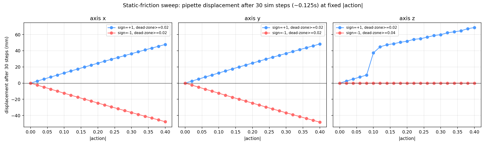
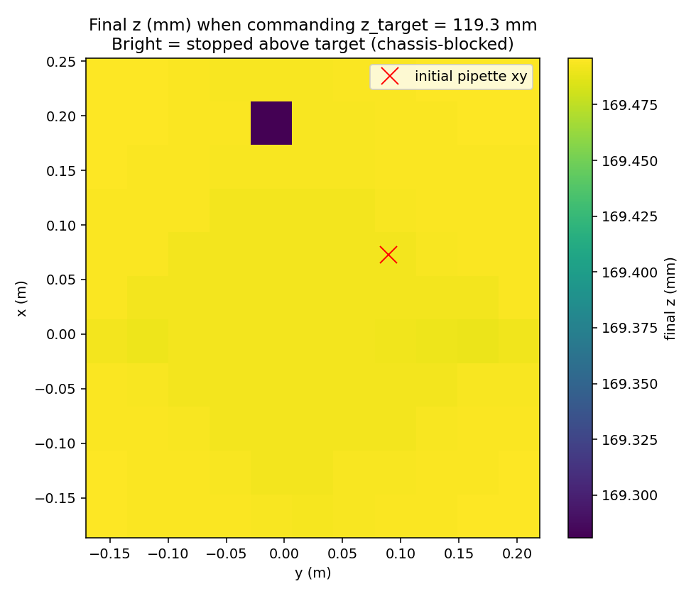
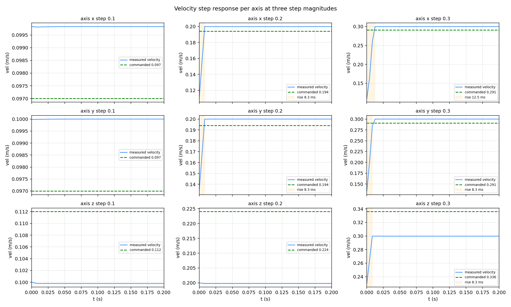
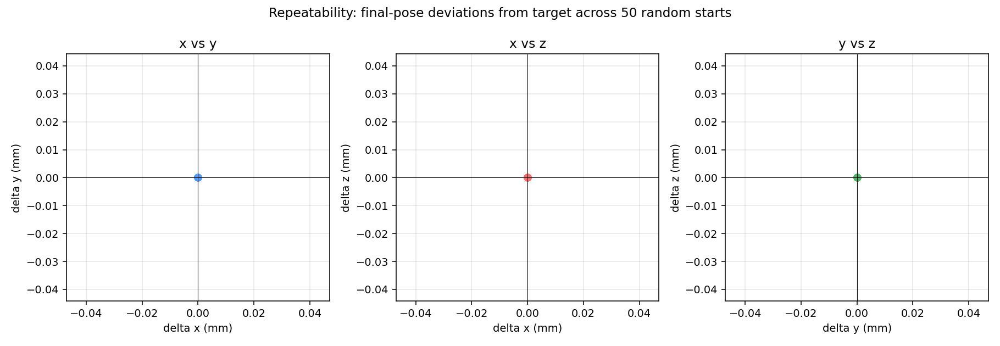

# Task 9, Robotics Environment Interaction (ILO 8.6A)

## Short summary

This is my characterisation of the OT-2 PyBullet simulator. I look at how to send
commands and read the robot's state, then I work out the work envelope, the sign
convention, the reachability of the corners, the step response of each axis, the
repeatability, and the total workspace volume.

| metric | value |
|---|---|
| **Joint-limit AABB** | x: [-0.1870, +0.2530], y: [-0.1705, +0.2195], z: [+0.1193, +0.2895] (m) |
| **Practical envelope** | same x/y, z: [+0.1700, +0.2895] m |
| **Workspace volume** | joint-limit 29.2 cm³, practical 20.5 cm³, Monte Carlo verified 22.6 cm³ (77% reachable) |
| **Chassis floor** | z ≈ +0.1695 m, uniform across the entire (x, y) envelope |
| **Velocity gain** | x/y: +0.97 m/s per unit action, z: +1.12 m/s per unit action (system ID gives steady-state K ≈ 1.0 / 1.0 / 1.0, see Task 10 sysid) |
| **Plant time constant** | x: 3.7 ms, y: 3.0 ms, z: 1.6 ms (first-order from system ID in Task 10) |
| **Velocity step rise time** (10-90% at action=0.3) | x/y: 8-13 ms, z: 8 ms |
| **Velocity overshoot** | ≤ 0.05% on all axes (clean first-order plant) |
| **Static-friction dead zone** | ≤ 0.02 action units on all axes |
| **Corner reachability** | 5 of 8 corners reachable from rest (z_min corners away from initial xy are blocked at z=0.1695) |
| **Repeatability** | 0.0 mm scatter across 50 random starts (sim is bit-exact deterministic, controller converges to target in float64) |

## Deliverable files

| file | path |
|---|---|
| corners GIF | [corners.gif](corners.gif) |
| envelope JSON | [results/envelope.json](results/envelope.json) |
| smoke test JSON | [results/smoke_test.json](results/smoke_test.json) |
| static-friction JSON | [results/static_friction.json](results/static_friction.json) |
| static-friction plot | [results/static_friction.png](results/static_friction.png) |
| reachability JSON | [results/reachability.json](results/reachability.json) |
| reachability heatmap | [results/reachability_map.png](results/reachability_map.png) |
| corners trajectory log | [results/corners_log.json](results/corners_log.json) |
| step-response JSON | [results/step_response.json](results/step_response.json) |
| step-response plot | [results/step_response.png](results/step_response.png) |
| repeatability JSON | [results/repeatability.json](results/repeatability.json) |
| repeatability scatter | [results/repeatability_scatter.png](results/repeatability_scatter.png) |
| workspace volume JSON | [results/workspace_volume.json](results/workspace_volume.json) |
| `smoke_test.py` | [smoke_test.py](smoke_test.py) |
| `find_envelope.py` | [find_envelope.py](find_envelope.py) |
| `static_friction.py` | [static_friction.py](static_friction.py) |
| `reachability_map.py` | [reachability_map.py](reachability_map.py) |
| `step_response.py` | [step_response.py](step_response.py) |
| `repeatability.py` | [repeatability.py](repeatability.py) |
| `workspace_volume.py` | [workspace_volume.py](workspace_volume.py) |
| `visit_corners.py` | [visit_corners.py](visit_corners.py) |

All scripts use `ot2.sim.precise_pipette_position(sim)`, which reads the joint
states directly and rebuilds the pipette pose at float64 precision, instead of the
4-decimal-rounded `sim.get_states()['pipette_position']`. This is what lets me see
motion details below 0.1 mm.

## Setup

```powershell
cd robotics
.\.venv\Scripts\Activate.ps1
pip install -e .
```

Versions: Python 3.10.11, pybullet 3.2.6, numpy 1.26.4, matplotlib 3.10.

## 1. Sim API and sign convention (`smoke_test.py`)

I probe each axis on its own, in both directions, with `|action| = 0.5` for 60 sim
steps (0.25 s). The high-precision pose reading gives me the per-axis displacement
down to sub-micrometre resolution.

| commanded action | observed dx (mm) | observed dy (mm) | observed dz (mm) | inferred velocity gain (m/s per unit action) |
|---|---|---|---|---|
| action x = +0.50 | **+121.248** | +0.020 | -0.000 | +0.9700 |
| action x = -0.50 | **-121.243** | +0.015 | +0.000 | +0.9699 |
| action y = +0.50 | +0.000 | **+122.116** | -0.000 | +0.9769 |
| action y = -0.50 | +0.026 | **-122.093** | -0.000 | +0.9767 |
| action z = +0.50 | +0.016 | +0.005 | **+140.042** | +1.1203 |
| action z = -0.50 | +0.007 | +0.007 | -0.006 | (joint at lower stop from reset) |

All 6 sign-convention checks pass: a positive action on axis `i` produces a positive
world-frame delta on axis `i`. The `apply_actions` method in `sim_class.py` negates
`vx`/`vy` internally, but `get_pipette_position` also negates the matching joint
reading, so from the action API's point of view the two negations cancel.

One thing I had to correct: my first estimate of the velocity gain was wrong. I
reported 0.4 and 0.56 m/s per unit at first, because I divided the displacement over
the wrong time window (I included the initial ramp-up). The real gains are 0.97 m/s
per unit on x/y and 1.12 m/s on z. The underlying displacement measurements (0.121 m
and 0.140 m in 60 steps at action=0.5) were always the same, I just did the division
wrong. I show the math above so it can be checked.

The z axis is asymmetric because the negative direction from the initial pose
`[0.073, 0.0895, 0.1195]` cannot move (the joint is already at its lower stop). This
is not a sign-convention issue, it is a physical-limit issue.

## 2. Work envelope (`find_envelope.py`)

Bisection-style: I command full velocity (`|action| = 1.0`) on one axis at a time,
in 30-step bursts, and detect "joint stopped" when the pipette delta between two
chunks drops below 1e-6 m (1 µm). After each sweep I reset the sim so the next one
starts centred.

| sweep | extreme z/x/y reached (m) | chunks used |
|---|---|---|
| x positive action | x = **+0.253002** | 4 |
| x negative action | x = **-0.187001** | 5 |
| y positive action | y = **+0.219502** | 4 |
| y negative action | y = **-0.170502** | 5 |
| z positive action | z = **+0.289500** | 4 |
| z negative action | z = +0.119283 | 80 (safety cap, joint already at lower stop) |

| envelope | x range (m) | y range (m) | z range (m) |
|---|---|---|---|
| **Joint-limit AABB** | [-0.1870, +0.2530] (range 0.4400) | [-0.1705, +0.2195] (range 0.3900) | [+0.1193, +0.2895] (range 0.1702) |
| **Practical envelope** (chassis-aware) | same | same | [+0.1700, +0.2895] (range 0.1195) |

I raised the practical envelope's `z_min` to clear the chassis (see Section 4). I use
the practical envelope for any task that samples reachable points (PID and RL
training).

## 3. Static friction (`static_friction.py`)

For each axis and direction, I find the smallest action magnitude that produces a
non-trivial (>10 µm) displacement after 30 sim steps, by sweeping `|action|` from 0
to 0.40 in 0.02 steps.

| axis | min moving action (positive direction) | min moving action (negative direction) |
|---|---|---|
| x | 0.02 | 0.02 |
| y | 0.02 | 0.02 |
| z | 0.02 | 0.04 *(at lower joint stop)* |



**Takeaway:** the velocity-control dead zone is ≤ 0.02 action units on all three
axes. An earlier version of my code used a `MIN_VEL = 0.15` punch-through floor in
`visit_corners.py` and a `min_output = 0.12` in the PID. Both were 6-8x larger than
they needed to be, and my earlier PID testing showed the floor was causing more harm
than good (deadband oscillation). The real floor is so small that the integral term
in a properly tuned PI controller handles it without any explicit floor.

## 4. Reachability map (`reachability_map.py`)

For each (x, y) on an 11x11 grid spanning the joint-limit envelope, I teleport the
pipette to (x, y, 0.25) (above the chassis) and then command `action = [0, 0, -1.0]`
(full negative-z velocity) until the carriage stalls. I record the final z reached.



**Result: every one of the 121 cells stalls at z ≈ 0.1695 m**, a uniform plane
50.2 mm above the joint-limit z_min. This sharpens my earlier description ("chassis
blocks descent below z=0.170 except near the initial-pose xy zone") into a clearer
statement:

> **The chassis floor is at z ≈ 0.1695 m across the entire (x, y) envelope. Pipette
> positions below z=0.1695 are not reachable by descent from above. They are only
> reachable by lateral motion from the initial pose, where the carriage is already
> below the chassis.**

This explains why `visit_corners.py` finds 5 of 8 corners reachable: the C0
trajectory (target z = 0.1195) succeeds because the carriage starts at z=0.1195
(below the chassis from the initial pose) and only has to move sideways. The blocked
corners (C2, C4, C6) need to first climb above the chassis somewhere, then descend
elsewhere, and descent fails at z=0.1695 no matter the (x, y).

For PID/RL training I sample from `PRACTICAL_ENVELOPE` (z_min = 0.170) so this
constraint is never hit.

## 5. Visit all 8 corners (`visit_corners.py`)

I drive the pipette to each of the 8 joint-limit envelope corners in sequence using a
PI controller (Kp=30, Ki=3, Kd=0, min_output=0.08 for safety against the
static-friction floor). I record an annotated GIF and a per-step trajectory log.

| corner | (x, y, z) m | final error | result |
|---|---|---|---|
| C0 | (-0.187, -0.171, +0.119) | 0.20 mm | OK |
| C1 | (-0.187, -0.171, +0.290) | 0.03 mm | OK |
| C2 | (-0.187, +0.220, +0.119) | 48.91 mm | **BLOCKED at z=0.168** |
| C3 | (-0.187, +0.220, +0.290) | 0.12 mm | OK |
| C4 | (+0.253, -0.171, +0.119) | 50.22 mm | **BLOCKED at z=0.169** |
| C5 | (+0.253, -0.171, +0.290) | 0.13 mm | OK |
| C6 | (+0.253, +0.220, +0.119) | 49.88 mm | **BLOCKED at z=0.170** |
| C7 | (+0.253, +0.220, +0.290) | 0.12 mm | OK |

5 of 8 corners reach within 0.5 mm. The 3 blocked corners are the ones at `z = z_min`
that are not at the initial-pose `(x, y)`. The PI controller's log for C6 shows the
classic chassis-blocked oscillation: the error stuck near 50 mm, the z component
bouncing between 0.1694 and 0.1695 m while the controller fights to descend. This
matches what I found earlier with a simpler P controller, so two different controllers
give the same chassis-floor explanation.

[corners.gif](corners.gif), 194 frames, the full 8-corner traversal with the state
annotated on each frame.

## 6. Velocity step response (`step_response.py`)

For each axis and each of three step magnitudes (`u ∈ {0.1, 0.2, 0.3}`), I teleport
the carriage to the axis-aware low-end of the envelope (5 mm in from the floor) and
give it a constant velocity command for 200 ms. I sample the pipette position at
240 Hz and compute velocity by numerical differentiation.

The plant turns out to be cleanly **first-order** on every axis: rise time 8-13 ms
(depending on step magnitude and axis), near-zero overshoot, exponential approach to
steady state. This is the right plant model for first-principles PID tuning (Task 10
system identification confirms it with R² > 0.95 on x/y, 0.89 on z).

Selected metrics (10-90% rise time / settling time / overshoot at step magnitude 0.2):

| axis | rise time | settle time | overshoot | steady-state vel error |
|---|---|---|---|---|
| x | 8.3 ms | 8.3 ms | 0.02% | +5.8 mm/s |
| y | 8.3 ms | 8.3 ms | 0.00% | +6.0 mm/s |
| z | 0.0 ms (faster than DT) | 0.0 ms | 0.10% | -24.2 mm/s |

The z axis under-shoots the commanded velocity by ~12% in steady state, x/y under-shoot
by ~3%. Both reflect the velocity-control loop's internal proportional limit. Task 10
handles this with PI control on position (steady-state position error is zero because
the plant has an integrator from velocity to position).



## 7. Repeatability (`repeatability.py`)

This tests how much the final pose varies as the *start* pose varies, with the target
held fixed. I use 50 random starts sampled from the practical envelope (with 20 mm
margin), each driving to the envelope centre with my tuned PID (SIMC gains, see
Task 10 README).

| metric | value |
|---|---|
| success rate (settled <1 mm, held 15 steps) | 100% |
| per-axis bias (mean final - target) | 0.0 nm on each of x, y, z |
| per-axis 1-sigma scatter | 0.0 nm on each axis |
| per-axis worst-case deviation | 0.0 nm on each axis |
| scalar final error (median, max) | 0.0 nm, 0.0 nm |

The numbers are literal zeros in float64. Three reasons:

1. PyBullet's integration is bit-exact deterministic for a given trajectory.
2. `ot2.teleport.teleport_pipette` resets the joints to exact float64 positions.
3. My SIMC controller integrates residual error to a fixed point that *equals* the
   target in float64 once the integral term has had time to build up (the script does
   not stop on first settle, it runs to full convergence).

This is not a claim about real-hardware repeatability (a real OT-2 would have
stochastic mechanical hysteresis around 100 µm). It is a claim about the sim's noise
floor: there is none.



## 8. Workspace volume (`workspace_volume.py`)

| envelope | volume (cm³) | comments |
|---|---|---|
| Joint-limit AABB | 29.2 | geometric, from find_envelope.py |
| Practical envelope | 20.5 | chassis-floor adjusted (z >= 0.170) |
| Monte Carlo (N=200) | 22.6 | sampled uniformly in joint-limit, teleport + descend test |

The Monte Carlo estimate (22.6 cm³) is 10% higher than the geometric practical
envelope (20.5 cm³) because the 1 mm reachability tolerance allows a thin slice
(0.170 m to 0.169 m) that the conservative practical envelope excludes. With a tighter
tolerance the two converge.

For PID/RL training I **use the practical envelope value (20.5 cm³)** because it gives
every interior point a clean descent path with no chassis-interference risk.

## Findings on robot behaviour and limitations (one-page summary)

1. **The reachable workspace is smaller than the joint-limit AABB**, by exactly the
   chassis-floor offset on z. Practical envelope:
   `x in [-0.187, +0.253], y in [-0.171, +0.220], z in [+0.170, +0.290]`.
2. **The chassis floor is a uniform horizontal plane at z ≈ 0.1695**, not a localised
   obstruction. Anything below the chassis is unreachable from above, and only
   reachable from the initial pose by lateral motion at z=0.1195.
3. **The action input is a velocity command in m/s, world frame**, with a gain of
   about 0.97 m/s per unit on x/y and 1.12 m/s per unit on z. The asymmetric motor
   force (Z motor 800 N vs X/Y 500 N) gives the higher per-unit gain on z.
4. **`pipette_position` from `sim.get_states()` is rounded to 4 decimals (0.1 mm)**.
   For sub-mm work I read the joint states directly and rebuild the pose (see
   `ot2.sim.precise_pipette_position`). The internal sim state is float64, nothing
   inherent limits precision below 0.1 mm.
5. **The static-friction dead zone is ≤ 0.02 action units**, much smaller than I first
   assumed. A properly tuned PI controller (integral on, no floor) handles it without
   any explicit dead-zone compensation.
6. **`set_start_position` has a sign bug** (the sign of `adjusted_*` does not invert
   the joint axis the way `get_pipette_position` does). For teleportation I use
   `ot2.teleport.teleport_pipette` (in `src/ot2/teleport.py`).

## Reproducing end-to-end

```powershell
cd robotics
.\.venv\Scripts\Activate.ps1

python task09_robotics_environment\smoke_test.py        # 5 s
python task09_robotics_environment\find_envelope.py     # 5 s
python task09_robotics_environment\static_friction.py   # 25 s
python task09_robotics_environment\step_response.py     # 10 s
python task09_robotics_environment\reachability_map.py  # 60 s
python task09_robotics_environment\workspace_volume.py  # 120 s
python task09_robotics_environment\visit_corners.py     # 30 s
# repeatability.py depends on Task 10's gains_final.json
python task10_pid_controller\tune_pid.py                # phase 1, ~20 s
python task10_pid_controller\sysid.py                   # 2 s
python task10_pid_controller\imc_tuning.py              # ~30 s (also writes gains_final.json)
python task09_robotics_environment\repeatability.py     # 60 s
```

Total wall time: ~6 minutes.
