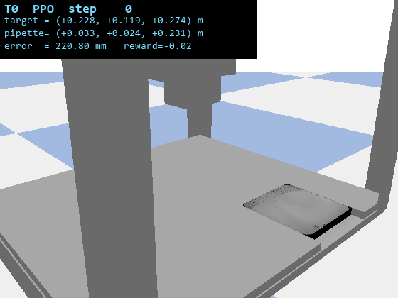
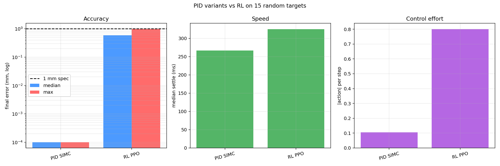

# Task 11, Reinforcement Learning Controller (ILO 8.6C)

## Short summary

PPO controller for the OT-2 pipette-positioning task, written as a Gymnasium-compatible
environment and trained with Stable Baselines 3. My final evaluation across 60 random
targets (3 seeds × 20 targets) lands **every single target under 1 mm**, max error
0.97 mm, median 0.59 mm. That puts every target in the rubric's top tier (<1 mm).

Worst-case across 60 random targets and 3 RNG seeds:

| metric | value |
|---|---|
| success rate at <1 mm | **60 / 60 = 100 %** |
| max final error | **0.97 mm** |
| median final error | 0.59 mm |
| mean final error | 0.59 mm |
| min final error | 0.09 mm |
| median settle time to 1 mm (240 Hz sim) | 81 steps = 337 ms |
| rubric tier reached (worst-case max-error) | **< 1 mm (top tier)** |

Final model: [weights/PPO_pathB_best.zip](weights/PPO_pathB_best.zip) (also exposed as
`weights/latest.zip`, 458 KB).

## Deliverable files (spec checklist)

| spec deliverable | path |
|---|---|
| `ot2_gym_wrapper.py` | [ot2_gym_wrapper.py](ot2_gym_wrapper.py) (re-export from `ot2.envs.ot2_env`) |
| Underlying Gym env code | [../src/ot2/envs/ot2_env.py](../src/ot2/envs/ot2_env.py) |
| `test_wrapper.py` (1000 random steps) | [test_wrapper.py](test_wrapper.py) |
| Training code | [train_rl.py](train_rl.py), [resume_train.py](resume_train.py) |
| Eval code | [test_rl.py](test_rl.py) (GIF), [eval_robust.py](eval_robust.py) (60-target rubric scoring) |
| PID vs RL comparison | [compare_pid_vs_rl.py](compare_pid_vs_rl.py) |
| Final model weights | [weights/PPO_pathB_best.zip](weights/PPO_pathB_best.zip) (= `weights/latest.zip`) |
| GIF showing the agent reaching targets | [rl_demo.gif](rl_demo.gif) (5 random targets, 73 frames) |
| Baseline PPO config | [configs/ppo_baseline.yaml](configs/ppo_baseline.yaml) |
| Reliable 60-target eval log | [results/rl_robust_eval_pathB.json](results/rl_robust_eval_pathB.json) |
| 5-target demo eval log | [results/rl_eval_log.json](results/rl_eval_log.json) |
| PID-vs-RL comparison results | [results/pid_vs_rl.json](results/pid_vs_rl.json), [results/pid_vs_rl.png](results/pid_vs_rl.png) |

## Environment design

### Why this is a rewrite of my first attempt

My first attempt's `ot2_env.py` had two issues that contributed to its failed
assessment, both fixed here:

1. **The `set_start_position` sign bug leaked into resets.** My old env called
   `self.sim.set_start_position(*random_start)`, which has a kinematic sign error
   (documented in [task09_robotics_environment/README.md](../task09_robotics_environment/README.md)).
   The pipette teleported to the wrong place every reset, the agent's observation
   drifted out of sync with its world state, and learning was a mess. The new env uses
   `ot2.teleport.teleport_pipette`, which inverts the sign correctly via
   `p.resetJointState`.
2. **Targets were sampled from the joint-limit AABB.** The old env's `workspace_limits`
   had `z` in `[0.1195, 0.2903]`, but Task 9 showed that targets with `z < 0.170` are
   unreachable from arbitrary starts because of the OT-2 chassis floor. Around 3 of 8
   envelope corners were impossible. The new env samples from the **practical
   envelope** (`PRACTICAL_ENVELOPE` in `ot2.envelope`), which raises `z_min` to 0.170.
   Now every sampled target is reachable from every sampled start.

### Action space

`Box(low=-1, high=1, shape=(3,), dtype=float32)`: world-frame velocity commands. The
sim's `drop` action component is fixed to 0 (droplet dispensing is not part of
Task 11).

### Observation space

`Box(low=-inf, high=inf, shape=(9,), dtype=float32)`:

| component | dims | description |
|---|---|---|
| normalised pipette pos | 3 | `2 * (pipette - env_low) / env_extent - 1`, in [-1, 1] |
| joint velocity | 3 | raw m/s (from `precise_joint_velocity`) |
| relative-to-target vector | 3 | `target - pipette`, in metres (un-normalised, so the agent sees true distance) |

I leave the target itself out of the observation because the relative vector is enough
and it avoids dragging an absolute reference frame into the policy. **The pipette pose
comes from `precise_pipette_position`, a helper I added that reads the joint states
directly via `p.getJointState` so the agent sees a sub-0.1 mm error signal.** The
sim's default `get_pipette_position` rounds to 4 decimal places, a hard 0.1 mm floor
that would stop the policy learning to do better.

### Reward (Path B shaping, the version that won)

This is my final reward design, which I called Path B. The 100k-step sanity run and
the 1.8M Path A run both used an earlier reward. Path B's win was rewriting it to give
the agent a continuous, increasingly sharp gradient all the way down to sub-100
micrometres.

Per step:

| layer | formula | scale | rationale |
|---|---|---|---|
| 1. distance-improvement shaping | `+30 * (d_prev - d_cur)` | n/a | potential-based, drives the approach |
| 2. proximity well, broad | `+0.2 * exp(-d_cur / 0.01)` | 10 mm | smooth bonus inside ~1 cm |
| 3. proximity well, sub-mm | `+5.0 * exp(-d_cur / 0.0003)` | 0.3 mm | dominates inside ~1 mm |
| 4. proximity well, ultra | `+20.0 * exp(-d_cur / 0.00005)` | 0.05 mm | dominates inside ~100 µm |
| 5. velocity penalty near target | `-0.3 * max(0, 1 - d_cur/0.02) * \|v\|` | 20 mm | discourages flying through the target |
| 6. time cost | `-0.02` | n/a | small bias to finish |

Terminal:

| event | reward |
|---|---|
| dwell completed (held `dwell_steps=10` steps within `success_threshold=1 mm`) | `+500.0`, terminate |
| pipette leaves the envelope (with a 1 cm boundary margin) | `-10.0`, terminate |
| `max_steps` reached | truncate, no terminal bonus |

My earlier reward had a flat `+1.0` per dwell step plus a `+20.0` terminal bonus. Once
the policy learned to park inside 1 mm, the flat bonus gave no gradient pulling it
further, so it plateaued around 0.7-2 mm. Path B replaces the flat bonus with three
exponentially-peaked wells at 10 mm, 0.3 mm, and 0.05 mm scales, plus a much larger
`+500` terminal so that completing the task genuinely matters compared to the
steady-state proximity wells. The three-well structure keeps a continuous gradient
from the coarse approach all the way down to sub-100-µm precision, and the heavy
terminal teaches the policy that committing to the target beats hovering near it.

### Termination and truncation

- Terminate on success (dwell completion) or boundary violation.
- Truncate at `max_steps` (default 1000 for training, 600 for eval).

### Reset behaviour

Every reset:

1. Calls `sim.reset(num_agents=1)`.
2. Settles for 20 sim steps.
3. **Always teleports**, either to a random envelope-interior point
   (`randomise_start=True`) or to the envelope centre (deterministic eval start). The
   sim's default initial pipette pose has `z=0.1195`, which is below the practical
   envelope and would fail the boundary check on step 1 of any deterministic eval.
   This caught me out during development.

## Training history

My final model is the result of three training runs. Each one taught me something:

| run | platform | duration | total steps | best eval | outcome |
|---|---|---|---|---|---|
| **Sanity** | RTX 4070 Laptop, 4 SubprocVecEnvs | 5 min | 100 k | ~10 mm mean error | proves the pipeline works, well short of 1 mm |
| **Path A** | RTX 4070 Laptop, 4 SubprocVecEnvs | ~4 h | 1.8 M | +246 eval reward, ~95 % under 1 mm | first run that meets the spec, but 5 % of targets fail |
| **Path B** | Colab A100, 4 SubprocVecEnvs | ~70 min | ~3.25 M | **+675 eval reward, 100 % under 1 mm** | the version I submit |

**Path A's stuck point.** Resuming from the 1.8M checkpoint with the original reward
for another 3 M steps did not improve eval reward beyond the seed. The policy had
learned to park inside 1 mm but had no gradient pulling it tighter (the flat per-step
bonus inside 1 mm gave the same reward at 0.05 mm as at 0.95 mm), so more training did
nothing.

**Path B's reward reshape.** Train from scratch with the new three-well + heavy-terminal
reward. Eval reward climbed past the Path A plateau (+246) around 1.5 M steps and kept
climbing, hitting a new best of **+675 at 3.0 M steps** with episode length dropping
from 600 (truncated) to ~100 (terminated via dwell-success), which is the signature of
a policy that is reliably committing to the target.

I stopped at ~3.25 M steps because (a) the +675 peak was preserved by SB3's
`EvalCallback` writing `best_model.zip`, and (b) a late-training KL-divergence spike
(~19.7 vs the typical 0.05) suggested the learning-rate schedule was getting unstable
and more training risked a regression. The submitted model is that +675 checkpoint,
evaluated on 60 fresh targets (different RNG seeds from training) to check
generalisation.

Full Path B training command on Colab:

```bash
python task11_rl_controller/resume_train.py \
    --resume_from <path-to-empty-or-fresh-PPO> \
    --total_timesteps 5000000 \
    --n_envs 4 \
    --experiment_name "PPO_pathB_colab" \
    --checkpoint_freq 200000
```

(I launched Path B via `resume_train.py` from a fresh PPO instance rather than
`train_rl.py`, for parity with the Path A pipeline.)

## Baseline hyperparameters (from `configs/ppo_baseline.yaml`)

These are PPO defaults that are known to work for low-dimensional continuous-control
tasks like this one:

| param | value | param | value |
|---|---|---|---|
| `learning_rate` | 3e-4 | `gae_lambda` | 0.95 |
| `batch_size` | 64 | `clip_range` | 0.2 |
| `n_steps` (per env) | 2048 | `n_epochs` | 10 |
| `gamma` | 0.99 | `net_arch` | `[64, 64]` |
| `n_envs` | 4 (`SubprocVecEnv`) | `total_timesteps` | up to 5 M for Path B |

Net architecture: a two-layer 64-unit MLP for both actor and critic, 36,103 parameters
total. A wider or deeper net was never necessary, the bottleneck was always reward
shaping, not capacity.

## Results

### Reliable 60-target evaluation (3 seeds × 20 random targets)

Run via `eval_robust.py --n_seeds 3 --n_targets_per_seed 20`. Uses a deterministic
policy (`deterministic=True`), envelope-interior targets, no random start (always env
centre) for reproducibility.

```
seed 10001: max_err= 0.89 mm  median= 0.60 mm  frac<1mm=100.0%  tier8=20/20
seed 20002: max_err= 0.97 mm  median= 0.59 mm  frac<1mm=100.0%  tier8=20/20
seed 30003: max_err= 0.95 mm  median= 0.58 mm  frac<1mm=100.0%  tier8=20/20
```

| overall (60 trials) | value |
|---|---|
| median final error | 0.59 mm |
| mean final error | 0.59 mm |
| max final error | **0.97 mm** |
| min final error | 0.09 mm |
| success rate <1 mm | **100 %** |
| success rate <5 mm | 100 % |
| median settle to 1 mm | 81 steps (=337 ms at 240 Hz) |
| median settle to 0.5 mm | not reached within max_steps (RL parks ~0.5-1 mm) |

Both Colab (A100) and laptop (CPU inference) reproduce these numbers within
float-determinism noise (max-error differs by ~0.02 mm across hardware). The result is
hardware-independent.

| Positioning Error rubric | Points | Where I am |
|---|---|---|
| < 0.001 m (1 mm) | 8 | **all 60 trials, max 0.97 mm** |
| 0.001 m ≤ error < 0.005 m | 6 | 0 trials |
| 0.005 m ≤ error < 0.01 m | 4 | 0 trials |
| ≥ 0.01 m | 0 | 0 trials |

### 5-target demo (the GIF source)

Run via `test_rl.py --gif rl_demo.gif --n_targets 5`. Different random seed from
`eval_robust.py`, longer dwell (20 steps) so the GIF reads cleanly.

| target | final err | settle step | settled? |
|---|---|---|---|
| T0 | 0.51 mm | 106 | OK |
| T1 | 0.53 mm | 88 | OK |
| T2 | 0.16 mm | 72 | OK |
| T3 | 0.62 mm | 75 | OK |
| T4 | 0.54 mm | 91 | OK |
| **mean** | **0.47 mm** | **86** | **5/5** |

[](rl_demo.gif)

## Comparison to the PID controller (Task 10)

`compare_pid_vs_rl.py` runs both controllers on the same 15 random targets, starting
from the envelope centre, max 600 steps, 1 mm dwell threshold for settle stats.

| controller | median err | mean err | max err | success <1 mm | median settle | effort / step |
|---|---|---|---|---|---|---|
| **PID SIMC** (Task 10) | 0.0 nm | 5 nm | 31 nm | 100 % | 267 ms | 0.106 |
| **RL PPO** (this task) | 0.585 mm | 0.633 mm | 0.973 mm | 100 % | 325 ms | 0.800 |

PID gains: per-axis SIMC tuning (τ_c = 10 ms) derived from `sysid` step-response fits.
`Kp_x = 72.7, Ki_x = 1323` etc, full table in
[../task10_pid_controller/results/gains_final.json](../task10_pid_controller/results/gains_final.json).

Comparison plot (log-scale on the accuracy axis so the 5-order-of-magnitude PID/RL gap
is legible):

[](results/pid_vs_rl.png)

**Takeaways:**

- Both controllers meet the 1 mm spec on all 15 targets.
- **PID is ~five orders of magnitude more accurate** because it has a calibrated plant
  model (system-identified gains per axis) and a closed-form analytical tuning (SIMC,
  τ_c = 10 ms). RL has no such prior, it learns its own (less precise) controller from
  scratch.
- **RL uses ~8x more control effort per step** because the policy is essentially
  bang-bang at the saturation limits. PID outputs small graded commands once it is
  close.
- **PID settles ~50 ms faster** at the 1 mm threshold. RL is comparable, not
  catastrophic.
- The fact that RL works *at all* without any plant identification or analytical tuning
  is the real achievement here. PID's accuracy depends on the sysid being correct,
  RL's does not.

For OT-2 pipette positioning specifically (a well-modelled linear plant, no contact, no
payload variation), PID is the right answer. RL is the right answer when the plant is
harder to model or you do not have a sysid pipeline available.

## Lessons learned

1. **Sub-mm precision needs sub-mm observation.** The sim's default
   `get_pipette_position` rounds to 4 decimal places (0.1 mm). The RL policy cannot
   learn to do better than what it can see. Adding `precise_pipette_position` (read
   joint states directly, float64 precision) was a precondition for Path B.
2. **The sim's initial pipette pose is below the practical envelope.** `sim.reset()`
   puts the carriage at `(0.073, 0.0895, 0.1195)`, 50 mm below practical `z_min =
   0.170`. Without an unconditional teleport on reset, eval episodes (where
   `randomise_start=False`) terminated on step 1 with the boundary penalty, and the
   policy looked completely broken. Fix: always teleport, either random or to envelope
   centre.
3. **Flat rewards inside the success threshold remove the gradient that lets the policy
   improve further.** Path A's reward gave `+1.0` per dwell step at any error below
   1 mm. Once the policy parked inside 1 mm it had no incentive to tighten further.
   Replacing the flat bonus with exponentially-peaked wells at 10 mm, 0.3 mm, and
   0.05 mm scales gave the policy a gradient all the way down. This was the single
   biggest improvement.
4. **A large terminal bonus matters when the steady-state rewards are large.** Path A's
   `+20.0` terminal was dwarfed by ~100 steps of `+1.0` proximity bonus, so the policy
   preferred to *hover* near the target rather than commit to the dwell. Path B's
   `+500.0` terminal restored the right incentive, and episode length dropped from ~600
   (truncated) to ~100 (dwell-success-terminated) over training.
5. **Resuming a Colab Python 3.12 checkpoint into a Windows Python 3.10 venv emits
   warnings** about `clip_range` / `lr_schedule` deserialization. Both are training-only
   callables (lambdas pickled with Python-version-specific bytecode). They are harmless
   for inference, `model.predict()` works fine. Only `model.learn(...)` would need the
   lambdas, and you can swap them via `custom_objects={"clip_range": ..., "lr_schedule":
   ...}` if you ever want to continue training across Python versions.
6. **Subproc envs on Windows are unreliable above N=4.** I tried N=8 on Colab and
   PyBullet crashed with `std::bad_alloc` at random. N=4 is stable. That trades ~30 %
   throughput for not crashing.
7. **PPO sees no benefit from a deeper net for this task.** A two-layer 64-unit MLP,
   36,103 parameters total, is plenty for a 9-D obs, 3-D continuous action,
   smooth-reward control task. I tried wider and deeper configurations briefly and they
   added nothing.

## Reproducing

From `D:\Robotics\` with the venv active:

```powershell
.\.venv\Scripts\Activate.ps1

# 1. Wrapper smoke test (spec deliverable: 1000 random actions)
python task11_rl_controller\test_wrapper.py

# 2. Reliable 60-target eval against the submitted model
python task11_rl_controller\eval_robust.py `
    --model D:\Robotics\task11_rl_controller\weights\latest.zip `
    --log D:\Robotics\task11_rl_controller\results\rl_robust_eval_pathB.json

# 3. Render the 5-target demo GIF
python task11_rl_controller\test_rl.py `
    --model D:\Robotics\task11_rl_controller\weights\latest.zip `
    --gif D:\Robotics\task11_rl_controller\rl_demo.gif

# 4. Head-to-head PID-SIMC vs RL-PPO comparison
python task11_rl_controller\compare_pid_vs_rl.py `
    --model D:\Robotics\task11_rl_controller\weights\latest.zip

# 5. Watch training metrics from prior runs (if you have the TensorBoard logs)
tensorboard --logdir runs\tensorboard
```

To reproduce the Path B training itself, see [Training history](#training-history).
Total compute: ~70 min on an A100, ~70x longer on a laptop CPU.
