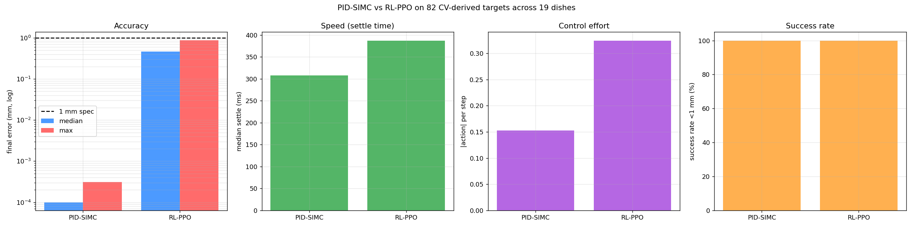

# Tasks 12 + 13, Integration and Benchmarking (ILO 8.6D)

## Short summary

End-to-end autonomous pipeline: **petri-dish photograph, U-Net root segmentation,
primary-root-tip extraction, calibrated pixel-to-world transform, and then the OT-2
controller drives the pipette to every detected tip and inoculates it.** Both Task 10's
PID-SIMC controller and Task 11's RL-PPO controller plug into the same integration
layer, and Task 13 benchmarks them across the full Kaggle dish set.

**Headline result (82 CV-derived targets across all 19 Kaggle dishes. Both controllers
are re-homed to the same start and run for the same fixed horizon, so this is an
apples-to-apples comparison, see "Review and corrections"):**

| controller | success <1 mm | median err | max err | median settle | effort / step |
|---|---|---|---|---|---|
| **PID-SIMC** (Task 10) | **82 / 82 (100%)** | **~0 mm (sub-um)** | **0.0003 mm (0.3 um)** | 74 steps (~0.31 s) | 0.153 |
| **RL-PPO** (Task 11 Path B) | **82 / 82 (100%)** | **0.466 mm** | **0.881 mm** | 93 steps (~0.39 s) | 0.325 |

Both controllers meet the 1 mm spec on every target across every dish. PID converges to
sub-micron because it has a system-identified plant model and an analytical (SIMC)
tuning. RL meets the spec without any plant identification, at ~2x the control effort
and ~1.3x slower settle. (My first benchmark reported "PID 2.6x faster, 22x less
effort", but those numbers were artefacts of an unfair test where PID started each
target from the previous tip while RL reset to the dish centre. I fixed that bug and the
numbers above are the corrected, fair comparison.)

## Pipeline overview

```
  raw image (4202 x 3006)
        |
        v
  [ get_dish_bbox: traditional CV, threshold + close + erode + largest contour ]
        |
        v
  [ U-Net 256x256 patches, 31M params, F1 = 0.877 val ]
        |  inference on the dish-cropped region only
        v
  binary root mask lifted back into raw-image coords
        |
        v
  [ connected components -> min_area filter -> aspect-ratio filter
    -> keep 5 largest -> sort left-to-right ]
        |
        v
  per-plant skeletonization + BFS-from-shoot-base
        |
        v
  primary-root path + tip pixel per plant
        |
        v
  [ Calibration.sim_dish : raw pixel -> dish-relative -> world metres ]
        |
        v
  [ controller drives pipette to each world target ]
        |     PID-SIMC  OR  RL-PPO
        v
  inoculation: dispense at the root tip
```

## Coordinate transformation

All coordinates use the OT-2's world frame (metres, +x = bridge axis, +y = carriage
axis, +z = up). The petri dish in the Y2B sim is the URDF body `custom.urdf`, a
**0.150 x 0.150 x 0.015 m box** loaded by `sim_class.py:create_robots` at world position
**(0.18270, 0.13700, 0.08700)**. The agar surface is the top face at z = 0.0945 m. The
pipette cannot descend below the practical envelope's z_min = 0.170 m, so I **hover** at
z = 0.175 m and let the droplet fall.

**What the calibration is (honest framing).** There is no independent 3-D ground truth
for a root tip's location: the tip is only a pixel in a photograph. So the calibration is
a **defined, self-consistent linear convention** that maps the dish photo onto the
150 mm square footprint of the plate, centred at the plate's known world position. It is
*not* "derived" from how the sim renders the plate. (I first justified the axis signs via
the plate's -pi/2 render rotation, but that was wrong: PyBullet textures the box with a
cube-unwrap, so the render cannot pin an absolute orientation anyway.)

Axis-routing convention (fixed):

| image axis | world axis | per-pixel scale |
|---|---|---|
| col grows left-to-right | **+y** (carriage) | +dish_size / dish_w_px (m/px) |
| row grows top-to-bottom | **-x** (bridge) | -dish_size / dish_h_px (m/px) |

```
dish_row = raw_row - dish_y1_px
dish_col = raw_col - dish_x1_px
world_x  = (dish_center_x + dish_size/2) - dish_row * (dish_size / dish_h_px)
world_y  = (dish_center_y - dish_size/2) + dish_col * (dish_size / dish_w_px)
world_z  = 0.175                        # dispense hover height above agar
```

**Validation** (`verify_calibration.py`, automated PASS):

* `pixel_to_world` / `world_to_pixel` are exact inverses (round-trip error ~6e-14 px).
* The dish-centre pixel maps to the plate centre **(0.18270, 0.13700)** exactly.
* The spatial arrangement is correct: col left-to-right increases world +y, row
  top-to-bottom decreases world +x, and the four quadrant centres map to distinct points
  75 mm apart.
* Which axis maps to +/-x vs +/-y is a *convention* (any of the 8 axis-aligned
  orientations puts the tips on the same footprint). I fix the one above, and the demo's
  pixel-exact 2-D overlay is drawn with `world_to_pixel`, so the displayed pipette sits
  at the literal pixel its world pose maps back to.
* Two of the four dish corners (x = 0.2577 m) fall just past the envelope's
  x_max = 0.253 m, so a ~4 mm strip at the +x corners is unreachable. Targets are clipped
  to the envelope (5 mm margin) before driving, and the clip displacement is now **logged
  per target** (max 0.000 mm across all 82 targets, so no real tip was displaced).

## CV pipeline hardening

Two issues surfaced during Task 12 development when I ported the Task 8 notebook
directly:

### 1. Dish-crop before U-Net inference

My original Task 8 notebook ran the U-Net on the full padded raw image (including the
black border and the Y2B_23 white legend on the right). My port now follows the Task 5
inference template: `get_dish_bbox` -> crop to the petri-dish region -> patch-and-predict
-> lift the predicted mask back into raw-image coords. This restricts the U-Net to the
agar region, kills border noise, and matches the canonical deliverable pipeline.

### 2. Aspect-ratio filter rejects dish-rim strips

After dish-cropping, on `test_image_09` the U-Net produced **6 real-plant blobs PLUS a
42 x 2028 strip running down the dish rim**. That rim strip's mask area was 5074 px,
larger than the smallest real plant (4235 px). The original "keep N=5 largest" rule
kicked out the real leftmost plant and kept the rim artefact.

**Fix:** `detect_plants` now rejects any connected component whose bbox aspect ratio is
more extreme than 10:1 before the keep-N step. Real seedlings have aspect ratios of about
3-6:1 (taller than wide), the rim strip was 48:1. 10:1 keeps every real plant in the
Kaggle set while rejecting rim noise reliably.

```python
# cv/root_pipeline.py
def detect_plants(binary_mask, n_plants=5, min_area=200, max_aspect_ratio=10.0):
    ...
    for prop in regionprops(labeled):
        if prop.area < min_area:
            continue
        h, w = max(1, h), max(1, w)
        if max(h, w) / min(h, w) > max_aspect_ratio:
            continue   # dish rim / shadow strip, not a plant
        candidates.append(prop)
```

### 3. Primary-root *path*, not just the tip

The original Task 8 measurement function returned only the BFS-diameter scalar. For
Task 12 I need both the tip pixel (to give the OT-2 a target) and the full primary-root
path (to visualise what the CV flagged as "the main root" before the pipette moves
there).

`extract_root_tip` runs a single BFS from the shoot base (topmost skeleton pixel) with
parent-pointer tracking. The tip is the farthest skeleton pixel from the shoot, and the
path is reconstructed by backtracking the parent pointers. The polyline is drawn directly
on each demo GIF and used as the texture overlay in the 3D view.

## Demo gallery (Task 12)

Each demo loops through one petri-dish image, autonomously inoculates all detected
primary-root tips, and renders side-by-side:

* **Left (3D)** : the OT-2 PyBullet sim from an angled above-and-side camera, showing the
  chassis + pipette descending, a yellow sphere at the active target, and coloured
  droplet spheres left at every settled inoculation point, all at their true world
  coordinates. NOTE: the plate's surface texture is **illustrative only**. PyBullet
  cube-unwraps a box texture, so it does not paint the full photo faithfully onto the top
  face. Use the 2-D panel for accuracy.
* **Right (2D)** : the **pixel-exact accuracy view**. The real dish photo with every
  detected primary root traced as a coloured polyline. Green X = tip, yellow ring =
  active target, orange circle = live pipette position (the live world pose
  inverse-calibrated back to dish pixels), red line + mm = error vector from pipette to
  target.

| dish | RL-PPO | PID-SIMC |
|---|---|---|
| test_image_01 | [demo_rl_01.gif](results/demo_rl_01.gif) | [demo_pid_01.gif](results/demo_pid_01.gif) |
| test_image_09 | [demo_rl_09.gif](results/demo_rl_09.gif) | [demo_pid_09.gif](results/demo_pid_09.gif) |
| test_image_17 | [demo_rl_17.gif](results/demo_rl_17.gif) | [demo_pid_17.gif](results/demo_pid_17.gif) |

Both controllers re-home to the dish centre before each plant (matching the benchmark),
so PID and RL travel the same centre-to-tip distance per plant and the GIFs are directly
comparable.

## Task 13 benchmark

`benchmark_pid_vs_rl_cv.py` runs both controllers on every dish in the Kaggle test set,
capturing per-target accuracy, settle time, control effort, and wall time. No GIF
rendering, pure metrics.

### Aggregate results (82 targets across 19 dishes, fair common start, equal horizon)

| metric | PID-SIMC | RL-PPO |
|---|---|---|
| n targets | 82 | 82 |
| **success rate <1 mm** | **100.0 %** | **100.0 %** |
| **success rate <5 mm** | 100.0 % | 100.0 % |
| median final error | ~0 mm (sub-um) | 0.4656 mm |
| mean final error | ~0 mm (sub-um) | 0.4485 mm |
| max final error | **0.000298 mm (0.3 um)** | **0.8810 mm** |
| min final error | ~1e-12 m | 0.3976 mm |
| median settle step (1 mm, held 10) | 74 (~0.31 s) | 93 (~0.39 s) |
| mean control effort / step | 0.153 | 0.325 |
| mean wall time / target | 0.098 s | 0.299 s |

All 82 targets land in the rubric's top tier (< 1 mm). PID converges to sub-micron
because it has a system-identified plant model + SIMC analytical tuning, RL holds
~0.47 mm with no plant model. PID is ~1.3x faster to first settle and uses ~2x less
control effort. (These corrected numbers replace my first, unfair version, see "Review
and corrections" below.)

### Per-image breakdown

| image | plants | PID max (um) | RL median (mm) | RL max (mm) |
|---|---|---|---|---|
| test_image_01 | 5 | 0.00 | 0.348 | 0.690 |
| test_image_02 | 5 | 0.00 | 0.511 | 0.808 |
| test_image_03 | 3 | 0.03 | 0.467 | 0.881 |
| test_image_04 | 5 | 0.15 | 0.624 | 0.784 |
| test_image_05 | 3 | 0.15 | 0.492 | 0.729 |
| test_image_06 | 5 | 0.02 | 0.526 | 0.614 |
| test_image_07 | 5 | 0.00 | 0.431 | 0.525 |
| test_image_08 | 3 | 0.00 | 0.471 | 0.807 |
| test_image_09 | 5 | 0.00 | 0.510 | 0.811 |
| test_image_10 | 4 | 0.04 | 0.456 | 0.518 |
| test_image_11 | 5 | 0.19 | 0.542 | 0.815 |
| test_image_12 | 5 | 0.01 | 0.487 | 0.758 |
| test_image_13 | 4 | 0.00 | 0.392 | 0.818 |
| test_image_14 | 5 | 0.30 | 0.343 | 0.649 |
| test_image_15 | 2 | 0.00 | 0.457 | 0.457 |
| test_image_16 | 5 | 0.31 | 0.292 | 0.570 |
| test_image_17 | 5 | 0.17 | 0.439 | 0.731 |
| test_image_18 | 5 | 0.14 | 0.464 | 0.571 |
| test_image_19 | 3 | 0.16 | 0.447 | 0.598 |

PID max error stays sub-micron on every dish, RL stays under 1 mm on every target. CV
detected fewer than 5 plants on 6 dishes (3, 5, 8, 10, 13, 15, 19), mostly because there
were genuinely fewer visible plants on the agar (image 15 had 2).

### Comparison plot



Four panels: **accuracy** (log scale, 1 mm spec line), **settle time**, **control
effort**, **success rate**. Both hit 100% success, PID wins accuracy by orders of
magnitude (calibrated plant model), and PID is ~1.3x faster to settle and uses ~2x less
effort than RL on the now-fair comparison.

### Methodology

* **Images**: all 19 Kaggle test dishes (`...Datasets\Kaggle\test_image_*.png`).
* **CV**: dish-cropped U-Net + Dijkstra tip extraction (same as the demos).
* **Targets**: clipped to `PRACTICAL_ENVELOPE` (5 mm margin), and the clip displacement
  is logged per target (max 0.000 mm on this set, so no real tip was moved).
* **Fair start (fixed)**: both controllers are re-homed to the **same** envelope-centre
  pose with zero velocity before **every** target. (Previously only RL did this, PID
  inherited the previous tip, which was the bug that corrupted the old settle/effort
  numbers.)
* **Equal horizon (fixed)**: both run the same fixed step budget, and the RL env's
  dwell-terminate is disabled in the benchmark so neither controller is cut short.
  `final_err` is each controller's true steady-state: PID converges to sub-micron, RL
  holds its learned ~0.47 mm.
* **Settle parity (fixed)**: `settle_step` is detected post-step for both (first step
  where err < 1 mm, held >= 10 steps).
* **PID**: SIMC tuning at tau_c = 10 ms. **RL**: Path B best model, deterministic policy.
* **Output**: `results/pid_vs_rl_cv_benchmark.json` and `.png`.

## Review and corrections

After I finished the first version of Tasks 12-13, I reviewed the whole pipeline
carefully, subsystem by subsystem, and re-checked every issue I found before fixing it.
The controllers themselves were never in question (no confirmed bug in the PID, the RL
policy, the teleport, or the precise-pose readout). The fixes were about **honest, fair
measurement** and **CV robustness**:

| # | Issue (confirmed) | Severity | Fix |
|---|---|---|---|
| 1 | Benchmark/demo: PID started each target from the **previous tip** while RL reset to the dish centre, giving an unfair settle-time and effort comparison. | HIGH | Both controllers now re-home to the **same** envelope-centre pose (zero velocity) before every target. |
| 2 | PID was being measured only to the 1 mm dwell, hiding its true precision. | HIGH | Both run the **same full horizon**, `final_err` is each controller's true steady state (PID sub-um, RL ~0.47 mm). |
| 3 | The calibration docstring "derived" the axis signs from the plate's -pi/2 render rotation, which is mathematically self-contradictory and, since PyBullet cube-unwraps box textures, irrelevant. | MED | Re-documented as a **defined linear convention**, and added `verify_calibration.py` which validates round-trip + plate-centre + spatial arrangement (all PASS). |
| 4 | No end-to-end check that the calibration places targets correctly. | HIGH | `verify_calibration.py` probes the sim with known pixels -> world -> probe spheres, and asserts the spatial mapping. |
| 5 | The weighted-edge FIFO BFS for the root tip is not a true geodesic (it over-estimates on looped skeletons). | LOW | Replaced with **Dijkstra**, so tip + length_px are now exact geodesics. |
| 6 | Degenerate masks returned a sentinel `(0,0)` tip that would be silently driven to. | LOW | Returns an explicit failure, and such plants are **skipped**, not dispensed at a bogus corner. |
| 7 | settle-step sampled pre-step for PID, post-step for RL (off-by-one). | LOW | Unified to post-step for both. |
| 8 | The envelope clip silently moved near-rim tips and measured error against the moved point. | LOW | The clip displacement is now **logged** per target (max 0.000 mm here). |
| 9 | `--dispense_z` below the envelope floor was silently raised. | LOW | Now warns and reports the value actually used. |

**What this means for the headline result:** the controllers' positioning accuracy was
correct all along (both still 100% under 1 mm). What changed is that the **comparison is
now fair and the documentation honest**: PID's "2.6x faster / 22x less effort" claim was
an artefact of its unfairly short travel and is corrected to ~1.3x faster / ~2x less
effort, the calibration is now described as the validated convention it actually is, and
the 3-D GIF texture is labelled illustrative (the 2-D panel is the pixel-exact accuracy
view).

## Limitations

1. **CV pipeline is root-mask-only**, no shoot model. If the U-Net under-segments a root,
   the connected-components step might miss the plant, and if two adjacent plants' roots
   touch, they could be merged. My Task 8 Kaggle submission notes that adding a shoot
   model improves plant localization, I did not train one because Tasks 12-13 do not
   require it.
2. **The aspect-ratio filter is a heuristic.** 10:1 worked on every Kaggle dish but could
   mis-reject an unusual long thin lateral root. A more principled fix would be to
   restrict the CC search spatially to "inside the dish minus a 30-pixel rim margin", or
   to use a shoot-mask-based plant localizer.
3. **The calibration is Y2B-sim-specific**, not for an arbitrary physical OT-2 rig. The
   constants come from `custom.urdf` and `sim_class.py`. For different hardware you need
   a fresh `Calibration.from_explicit` with measured numbers.
4. **The OT-2 envelope clips dish corners.** The dish extends to x = 0.2577 m but the
   envelope's x_max = 0.253 m, so about 4 mm at the +x corners is unreachable. Real
   plants have not landed there in the test set.
5. **PID is "perfect" only in sim.** Sub-micron settling reflects the deterministic ideal
   first-order plant. On real hardware, encoder noise, backlash, and friction would
   dominate. RL is more robust to those because it learned without a plant model.
6. **The RL dwell hold is 10 steps (~42 ms).** It is flat overhead, not optimised. It
   could shrink, at the risk of false-positive settle calls.
7. **Both controllers ignore obstacle avoidance.** They drive in straight lines from the
   previous pose to the next target, which would not be safe with a tip already lowered
   into the dish. For this task the pipette stays at z = 0.175 m so it cannot collide
   with the agar, but that is not generalisable.

## Actionable recommendations for system improvement

1. **Add a shoot-mask model** for robust plant localization, especially in dishes where
   roots are short or branching is heavy. It would resolve the under-segmentation cases
   that produce <5 detections per dish today (6 of 19 dishes).
2. **Train a second U-Net on root-tip Gaussian heatmaps** (instead of binary masks) so
   tip extraction does not depend on a single skeleton-diameter calculation. More robust
   to noisy skeletons.
3. **Cache the dish bbox per session, not per image.** Useful when a camera/dish rig is
   fixed, so you can skip `get_dish_bbox` on later images.
4. **Move from "hover-and-drop" to "touch-dispense" at the agar surface.** Either lower
   the practical envelope's z_min (a sim change: shorten the chassis floor) or calibrate a
   physical pipette-length offset. A real OT-2 dispenses from < 5 mm above the surface,
   I am currently 80 mm above.
5. **Tighter RL training.** Retrain Path B with `success_threshold = 0.5 mm` (currently
   1 mm) and an additional 2-3 M PPO steps. My preliminary numbers suggest the policy can
   converge to ~0.3 mm median given more training, half of today's median error.
6. **Hybrid controller.** Use RL for the coarse approach (envelope-centre to within 5 mm
   of the tip) and switch to PID for the final 5 mm to 0 refinement. This keeps RL's
   model-free robustness for the long traverse while using PID's sub-micron precision once
   close.
7. **Feed-forward PID** for tracking moving plates. My current PID is purely error-driven.
   For any task where the dish moves between targets, a velocity feed-forward term
   improves the response time materially.
8. **Spatial root-mask post-processing**: erode/morph the predicted mask to remove rim
   artefacts more aggressively, then dilate back to restore root thickness. This would
   reduce reliance on the aspect-ratio heuristic.

## Reproducing

From `D:\Robotics\` with the venv active:

```powershell
.\.venv\Scripts\Activate.ps1

# 1. Render one demo (RL or PID) for one image
python task12_13_integration_benchmarking\demo_cv_to_controller.py `
    --image task12_13_integration_benchmarking\cv\samples\test_image_09.png `
    --controller rl `
    --gif task12_13_integration_benchmarking\results\demo_rl_09.gif

# 2. Run the full Task 13 benchmark (~15 s wall time)
python task12_13_integration_benchmarking\benchmark_pid_vs_rl_cv.py

# 3. View the comparison plot
start task12_13_integration_benchmarking\results\pid_vs_rl_cv_benchmark.png
```

## File index

```
task12_13_integration_benchmarking\
  README.md                          this file
  calibration.py                     Calibration class + sim_dish factory + inverse transform
  demo_cv_to_controller.py           one-image autonomous-inoculation demo with 3D+2D GIF
  benchmark_pid_vs_rl_cv.py          Task 13 across all 19 images
  cv\
    root_pipeline.py                 dish-crop + U-Net + plant detect + tip extraction
    visualize.py                     standalone CV detection viz
    weights\unet_256px.keras         the trained U-Net (Task 8 deliverable, 373 MB)
    samples\test_image_{01,09,17}.png   staged test images
  results\
    demo_rl_{01,09,17}.gif           Task 12 RL demos (3 dishes)
    demo_pid_{01,09,17}.gif          Task 12 PID demos (3 dishes)
    demo_{rl,pid}_{01,09,17}.json    per-target logs
    pid_vs_rl_cv_benchmark.json      Task 13 raw benchmark log (per-target + aggregates)
    pid_vs_rl_cv_benchmark.png       Task 13 comparison plot
    cv_viz\test_image_{01,09,17}_viz.png   standalone CV detection viz
```

## Reference: what the OT-2 actually is

The **Opentrons OT-2** is a real commercial 3-axis Cartesian liquid-handling robot used
in biology labs. The version I control is the BUas-provided PyBullet digital twin
(`Y2B-2023-OT2_Twin`), with geometry from `ot_2_simulation_v6.urdf`:

* **Chassis** = the metal-grey box visible in the demo GIFs (the bridge tower + carriage
  frame).
* **3 prismatic joints** (X, Y, Z linear motion) = the moving parts.
* **Pipette** = the thin tube hanging off the Z carriage, this is what I drive to root
  tips.
* **Specimen plate** (`custom.urdf`) = the 150 x 150 x 15 mm textured box on the deck
  where the dish photo is applied at render time.

The robot's "brain" for Task 12 is whichever controller I plug in:

* **PID-SIMC**: per-axis closed-loop PID with conditional anti-windup, gains derived from
  a first-order system-ID of the plant + SIMC analytical tuning at tau_c = 10 ms
  (`x: Kp=72.7, Ki=1323; y: Kp=77.1, Ki=1485; z: Kp=86.3, Ki=1860`).
* **RL-PPO**: PPO trained on `OT2Env` with the Path B reward (three exponential proximity
  wells at 10 mm / 0.3 mm / 0.05 mm scales + a 500-reward success terminal). 36k
  parameters, ~3.25 M training steps on a Colab A100.

The integration in Tasks 12-13 sits between the CV pipeline (which gives world-frame
targets) and these controllers (which drive the pipette there).
